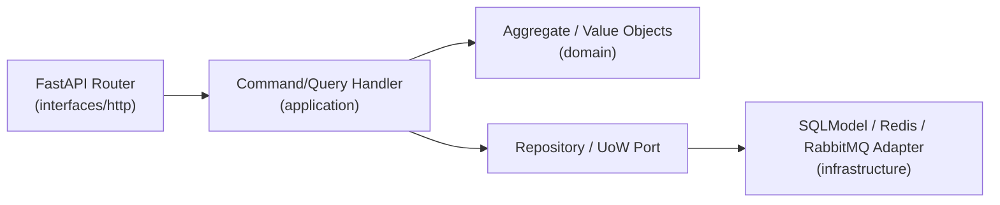

# ARTICLE-[ID]: [Título Técnico del Caso de Uso / Vertical Slice]

> Especificación Python / FastAPI / pytest de [`ARTICLE_TEMPLATE.md`](ARTICLE_TEMPLATE.md). Idioma: español; identificadores de código en inglés.

* **Artículo ID:** ARTICLE-[ID]
* **User Story:** [US-XX: Título de la Historia]
* **Bounded Context:** [e.g. conversations]
* **Tipo de Slice:** [Command (Escritura) | Query (Lectura)]
* **Rama de Trabajo:** `feat/[US-XX-slug]`
* **Squash Commit en main:** `pendiente`
* **Fecha:** YYYY-MM-DD
* **Autor / Tech Lead:** [Nombre]

---

## 1. Resumen Ejecutivo y Problema de Negocio

[Problema de negocio resuelto, capacidad incorporada e impacto en tenants y usuarios.]

---

## 2. Diseño Arquitectónico del Vertical Slice

Conforme a **Arquitectura Hexagonal + DDD** y [`.agent/rules/00-core-philosophy.md`](../rules/00-core-philosophy.md):



### Componentes Clave del Slice

* **Punto de Entrada (Driver Adapter):** `interfaces/http/rest/v1/[context]/router.py`
* **Mensaje de Aplicación:** `application/commands/[action]/command.py`
* **Orquestador:** `application/commands/[action]/command_handler.py`
* **Entidades e Invariantes:** `domain/entities/[aggregate]/aggregate.py`
* **Puertos Secundarios (SPI):** `application/ports/[concept]/repository.py`
* **Adaptadores de Infraestructura:** `infrastructure/persistence/...`
* **Diagrama vivo actualizado:** [`system-map.mermaid.md`](../architecture/system-map.mermaid.md)

---

## 3. Decisiones de Dominio Táctico y Aislamiento Multitenant

### 3.1. Invariantes y Value Objects

[Value Objects inmutables (`@dataclass(frozen=True)`), reglas de validación y cómo evitan Primitive Obsession.]

### 3.2. Aislamiento por Tenant

[Validación de contexto de tenant, filtros obligatorios en repositorios y particionamiento de claves de caché.]

---

## 4. Evidencia de Pruebas (Pirámide Completa)

Desarrollo bajo **Double-Loop TDD**. La evidencia debe ser salida real de `pytest`.

### 4.1. Pruebas Unitarias (Domain & Application)

* **Archivos:** `tests/unit/[context]/...`
* **Comando:** `pytest tests/unit/[context] -v`
* **Resultado:**

```text
[pegar salida real: N passed in X.XXs]
```

### 4.2. Pruebas de Integración (Adapters & HTTP)

* **Archivos:** `tests/integration/[context]/...`
* **Comando:** `pytest tests/integration/[context] -v`
* **Resultado:**

```text
[pegar salida real]
```

### 4.3. Pruebas de Aceptación BDD (pytest-bdd)

* **Archivo Feature:** `tests/acceptance/features/[feature].feature`
* **Comando:** `pytest tests/acceptance -v`
* **Escenario en Verde:**

```gherkin
Scenario: [Nombre del escenario principal validado]
  Given ...
  When ...
  Then ...
```

### 4.4. Pruebas End-to-End (omitir si el slice no aplica)

* **Archivo:** `tests/e2e/[spec].py`
* **Comando:** `pytest tests/e2e -v`
* **Resultado:** [Validación del flujo de caja negra]

---

## 5. Lecciones Aprendidas y Concesiones (Trade-offs)

1. **Trade-off 1:** [...]
2. **Trade-off 2:** [...]

---

## 6. Historial de Trazabilidad y Commits

### Historial de la Feature Branch (`feat/[US-XX-slug]`)

* `[hash]`: `test(acceptance): define gherkin scenarios for US-XX [expected red]`
* `[hash]`: `test(domain): add failing test for [concept] [red]`
* `[hash]`: `feat(domain): implement [concept] to pass test [green]`
* `[hash]`: `refactor(domain): clean up [concept] adhering to rules`
* `[hash]`: `docs(publication): add technical article for US-XX`

### Commit Final en `main` (Squash Merge)

* `pendiente` — `feat([context]): implement US-XX [slug] complete slice`

