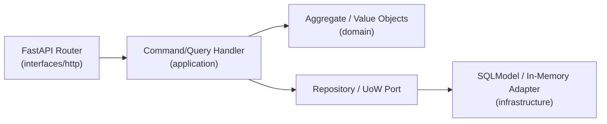

# ARTICLE-001: Contrato Estandarizado de Mensajería Conversacional con Idempotencia Resiliente (RFC-33 / CU-03)

> Especificación Python / FastAPI / pytest de [`ARTICLE_TEMPLATE.md`](../../.agent/templates/ARTICLE_TEMPLATE.md). Idioma: español; identificadores de código en inglés.

* **Artículo ID:** ARTICLE-001
* **User Story:** CU-03: Consola Conversacional con Idempotencia Resiliente (RFC-33)
* **Bounded Context:** `conversations`
* **Tipo de Slice:** Command (Escritura) | Query (Lectura)
* **Rama de Trabajo:** `development`
* **Squash Commit en main:** `pendiente`
* **Fecha:** 2026-11-13
* **Autor / Tech Lead:** Angel Szymczak

---

## 1. Resumen Ejecutivo y Problema de Negocio

En redes móviles o conexiones empresariales inestables, los usuarios de la consola conversacional enfrentan tres riesgos críticos:
1. **Doble Envío Accidental (*Double Submit*):** Clics repetidos en el botón de envío que disparan inferencias LLM duplicadas y cargos redundantes al presupuesto del tenant.
2. **Reintentos en Vuelo (*In-Flight Retries*):** Reconexiones tras timeouts de red que duplican mensajes o bifurcan el historial conversacional.
3. **Recarga de Sesión sin Estado de Turno:** Ausencia de un contrato de lectura (`GET /conversations/{conversation_id}`) que hidrate los mensajes previos con su `idempotency_key` y el indicador `can_append_user_message`.

Este vertical slice implementa el contrato **RFC-33** en `apps/chatbot/service/api`, habilitando deduplicación determinista por `X-Idempotency-Key` (UUIDv4 RFC 4122) con indicador `cached: true`, detección de colisiones en vuelo (`409 IDEMPOTENCY_IN_PROGRESS`) y de mutación de payload (`409 IDEMPOTENCY_PAYLOAD_MISMATCH`), aplicación de la invariante de alternancia de turnos (`400 TURN_INVARIANT_VIOLATED`) y consulta aislada por tenant (`GET /conversations/{conversation_id}`).

---

## 2. Diseño Arquitectónico del Vertical Slice

Conforme a **Arquitectura Hexagonal + DDD** y [`.agent/rules/00-core-philosophy.md`](../../.agent/rules/00-core-philosophy.md):



### Componentes Clave del Slice

* **Punto de Entrada (Driver Adapter):** `src/interfaces/http/routers/conversations_router.py`
* **Mensaje de Aplicación (Escritura):** `src/application/conversations/commands/send_message.py`
* **Mensaje de Aplicación (Lectura):** `src/application/conversations/queries/get_conversation.py`
* **Orquestador de Idempotencia:** `src/application/shared/idempotency/idempotent_command_executor.py`
* **Entidades e Invariantes:** `src/domain/conversations/entities/conversation.py` y `src/domain/conversations/value_objects/message.py`
* **Puertos Secundarios (SPI):** `src/domain/conversations/ports/conversation_repository.py` y `src/application/shared/ports/idempotency_repository_port.py`
* **Adaptadores de Infraestructura:** `src/infrastructure/persistence/mssql/repository.py` y `src/infrastructure/persistence/mssql/mapper.py`
* **Diagrama vivo actualizado:** [`.agent/architecture/system-map.mermaid.md`](../../.agent/architecture/system-map.mermaid.md)

---

## 3. Decisiones de Dominio Táctico y Aislamiento Multitenant

### 3.1. Invariantes y Value Objects

* **`IdempotencyKey` (`src/domain/conversations/value_objects/idempotency_key.py`):** Encapsula la validación estricta de UUIDv4 (RFC 4122) mediante `IdempotencyKey.from_uuid_v4(raw)`, lanzando `InvalidUuidFormatError` (traducido a HTTP `422 INVALID_UUID_FORMAT`) cuando el encabezado `X-Idempotency-Key` no cumple la expresión regular canónica, a la vez que preserva compatibilidad con el encabezado heredado `Idempotency-Key`.
* **`Message` (`src/domain/conversations/value_objects/message.py`):** Value Object inmutable (`@dataclass(frozen=True)`) enriquecido con `id: UUID` e `idempotency_key: str | None` configurados con `compare=False`, garantizando trazabilidad por mensaje sin romper la igualdad estructural por valor `(role, content, created_at)`.
* **`Conversation` (`src/domain/conversations/entities/conversation.py`):** El Aggregate Root gobierna la invariante de alternancia de turnos a través de la propiedad `can_append_user_message` y el método `append_user_message`, que lanza `ConsecutiveUserMessageError` (`400 TURN_INVARIANT_VIOLATED`) si el último mensaje registrado ya pertenece al rol `user`.

### 3.2. Aislamiento por Tenant

Cada instancia de `Conversation` almacena su `tenant_id` propietario desde la creación (`Conversation.create(title, tenant_id)`). Tanto la consulta `GetConversationQueryHandler` (`GET /conversations/{conversation_id}`) como la mutación `SendMessageCommandHandler` verifican que el `tenant_id` del contexto activo (`X-Tenant-Id`) coincida con el propietario del agregado; ante cualquier discrepancia entre tenants se lanza `ConversationNotFoundError` (`404 CONVERSATION_NOT_FOUND`), impidiendo fugas de información o enumeración cruzada.

---

## 4. Evidencia de Pruebas (Pirámide Completa)

Desarrollo bajo **Double-Loop TDD**. La evidencia corresponde a ejecuciones reales de `pytest`.

### 4.1. Pruebas Unitarias (Domain, Application & HTTP Interfaces)

* **Archivos:**
  * `tests/unit/domain/test_conversation.py`
  * `tests/unit/domain/test_message.py`
  * `tests/unit/domain/test_idempotency_key.py`
  * `tests/unit/application/test_get_conversation_query.py`
  * `tests/unit/application/test_idempotent_command_executor.py`
  * `tests/unit/interfaces/http/test_idempotency_dependency.py`
  * `tests/unit/interfaces/http/test_problem_details.py`
* **Comando:**
  `.venv/bin/pytest tests/unit/domain/test_conversation.py tests/unit/domain/test_message.py tests/unit/domain/test_idempotency_key.py tests/unit/application/test_get_conversation_query.py tests/unit/application/test_idempotent_command_executor.py tests/unit/interfaces/http/test_idempotency_dependency.py tests/unit/interfaces/http/test_problem_details.py -v`
* **Resultado:**

```text
tests/unit/domain/test_conversation.py ........                          [ 15%]
tests/unit/domain/test_message.py ........                               [ 30%]
tests/unit/domain/test_idempotency_key.py ..........                     [ 49%]
tests/unit/application/test_get_conversation_query.py ..                 [ 52%]
tests/unit/application/test_idempotent_command_executor.py ......        [ 64%]
tests/unit/interfaces/http/test_idempotency_dependency.py ...........    [ 84%]
tests/unit/interfaces/http/test_problem_details.py ........              [100%]

============================== 53 passed in 2.38s ==============================
```

### 4.2. Pruebas de Integración (Adapters & HTTP)

* **Archivos:**
  * `tests/integration/api/test_idempotent_requests.py`
  * `tests/integration/test_walkthrough_happy_path.py`
* **Comando:**
  `.venv/bin/pytest tests/integration/api/test_idempotent_requests.py tests/integration/test_walkthrough_happy_path.py -v`
* **Resultado:**

```text
tests/integration/api/test_idempotent_requests.py ....                   [ 80%]
tests/integration/test_walkthrough_happy_path.py .                       [100%]

============================== 5 passed in 1.72s ===============================
```

### 4.3. Escenarios de Contrato Validados (RFC-33)

* **Archivo de Especificación:** `docs/roadmap/rfc/RFC-33-backend-chat-idempotency-contract.md`
* **Escenario Principal en Verde:**

```gherkin
Scenario: Reintento idempotente con X-Idempotency-Key (UUIDv4) y consulta de historial por tenant
  Given una conversación creada por el tenant "tenant-alpha"
  When el cliente envía POST /conversations/{id}/messages con X-Idempotency-Key UUIDv4 válido
  Then el backend persiste el mensaje y responde 200 OK con cached=false
  And al reintentar con la misma clave y mismo payload responde 200 OK con cached=true desde caché
  And al reintentar con la misma clave y distinto payload responde 409 IDEMPOTENCY_PAYLOAD_MISMATCH
  And al enviar un segundo mensaje consecutivo del usuario responde 400 TURN_INVARIANT_VIOLATED
  And al consultar GET /conversations/{id} desde otro tenant responde 404 CONVERSATION_NOT_FOUND
```

### 4.4. Suite Completa del Servicio (Regresión Global)

* **Comando:** `.venv/bin/pytest tests/ -v`
* **Resultado:** `680 passed, 21 skipped in 38.94s`

---

## 5. Lecciones Aprendidas y Concesiones (Trade-offs)

1. **Trade-off 1 — Soporte Dual de Encabezados (`X-Idempotency-Key` vs `Idempotency-Key`):** Para alinear el contrato estricto RFC-33 con el Portal Web (`X-Idempotency-Key` con validación UUIDv4 RFC 4122 y error `422 INVALID_UUID_FORMAT`) sin romper clientes o suites de integración heredadas que utilizan `Idempotency-Key` alfanumérico, la dependencia HTTP `get_optional_idempotency_key` prioriza `X-Idempotency-Key` bajo validación estricta UUIDv4 y conserva `Idempotency-Key` como fallback retrocompatible.
2. **Trade-off 2 — Huella de Payload (`_payload_fingerprint`) Embebida en `response_payload`:** En lugar de alterar la firma de todos los repositorios de idempotencia (In-Memory y MSSQL) para añadir una columna dedicada al hash del payload, `IdempotentCommandExecutor` envuelve de forma transparente la huella SHA-256 (`_payload_fingerprint`) junto con el resultado serializado (`_data`). Esto permite detectar colisiones de payload (`409 IDEMPOTENCY_PAYLOAD_MISMATCH`) y aplicar mutaciones en hit de caché (`on_cache_hit` → `cached: True`) manteniendo intacto el puerto `IdempotencyRepositoryPort`.
3. **Trade-off 3 — Metadatos de Identidad en Value Object `Message` (`compare=False`):** En DDD, un `ValueObject` se compara por el valor de sus atributos de negocio (`role`, `content`, `created_at`). Al incorporar `id` e `idempotency_key` con `field(compare=False)`, satisfacemos la reconciliación de UI del frontend (RFC-33) sin degradar la semántica de igualdad estructural del Value Object en el dominio.

---

## 6. Historial de Trazabilidad y Commits

### Historial de la Rama (`development`)

* `9b16ab6`: `docs(rfc): add RFC-33 backend chat idempotency contract`
* `6cf739f`: `feat(conversations): enforce RFC-33 domain invariants, UUIDv4 idempotency key, and turn state`
* `04018c8`: `test(conversations): add unit tests for UUIDv4 idempotency key, message metadata, and turn state`
* `4ed77b0`: `feat(conversations): add get_conversation query, payload fingerprint idempotency, and tenant isolation`
* `6255154`: `test(conversations): add unit tests for get_conversation query and idempotency payload mismatch`
* `cefb7c2`: `feat(persistence): add idempotency_key to MessageModel, ConversationMapper, and migration 0009`
* `82f0156`: `test(persistence): verify tenant_id and idempotency_key mapping in ConversationMapper`
* `4cdc5de`: `feat(http): expose GET /conversations/{id}, X-Idempotency-Key UUIDv4 contract, and RFC 7807 handlers`
* `dd52542`: `test(http): add unit tests for X-Idempotency-Key UUIDv4, RFC 7807 codes, and container wiring`
* `d9e323a`: `docs(architecture): sync system-map.mermaid.md with GetConversationQueryHandler and InvalidUuidFormatError`
* `4f892e8`: `test(integration): add RFC-33 integration tests for X-Idempotency-Key, cached replay, and GET /conversations/{id}`

### Commit Final en `main` (Squash Merge)

* `pendiente` — `feat(conversations): implement CU-03 RFC-33 chat idempotency contract complete slice`

