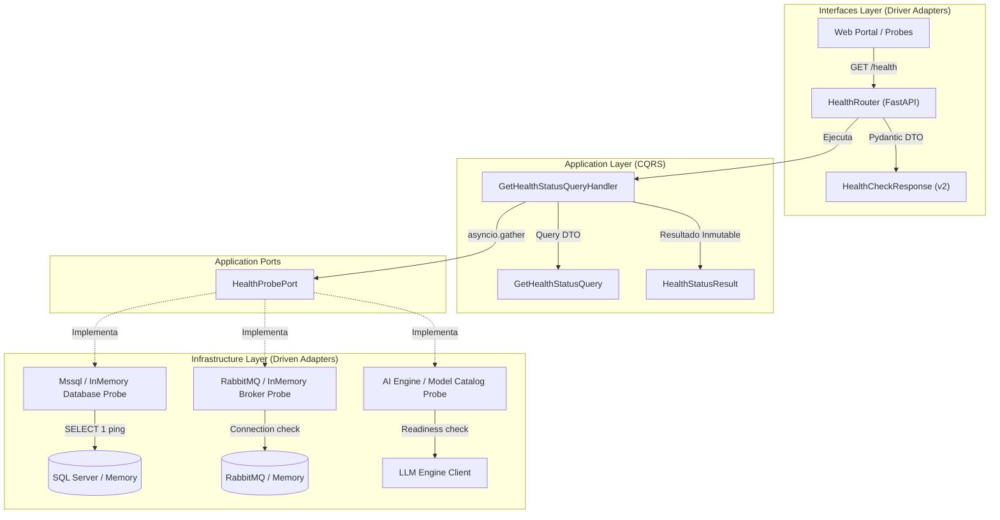

# Roadmap de Implementación — CU-01: Contrato de Observabilidad y Diagnóstico de Salud (`GET /health`)

Este documento constituye la especificación técnica y ruta de ejecución paso a paso para el **Caso de Uso 01 (CU-01: Monitor de Salud y Disponibilidad del Sistema)**, sincronizado con [`docs/frontend_portal_use_cases.md`](../frontend_portal_use_cases.md) y el **Paso 1** de la guía en vivo ([`README.md`](../../README.md)).

---

## 🎯 Objetivo del Caso de Uso

Evolucionar el endpoint de diagnóstico básico `GET /health` desde un stub primitivo `{"status": "ok"}` hacia un **contrato de observabilidad profunda de nivel enterprise**, permitiendo que el Frontend Web Portal (`apps/chatbot/web/portal`) y orquestadores de infraestructura inspeccionen la salud y latencia en milisegundos de cada dependencia crítica:

```json
{
  "status": "healthy",
  "version": "1.0.0",
  "checks": {
    "database": { "status": "healthy", "latency_ms": 8, "engine": "mssql" },
    "broker": { "status": "healthy", "latency_ms": 4, "engine": "rabbitmq" },
    "ai_engine": { "status": "healthy", "latency_ms": 32 }
  }
}
```

---

## 🏛️ Diagnóstico de Arquitectura y Deuda Técnica

Actualmente, el flujo de `/health`:
- [x] Está registrado como una función privada inline `_register_health_routes(app)` dentro de [`src/interfaces/http/api.py`](../../src/interfaces/http/api.py), devolviendo un simple diccionario no tipado `{"status": "ok"}`.
- [x] No existe el router modular [`src/interfaces/http/routers/health_router.py`](../../STRUCTURE.md) previsto en la arquitectura de driver adapters.
- [x] Viola el principio CQRS de Clean Architecture (`00-core-philosophy.md`): no cuenta con un Query Handler (`GetHealthStatusQueryHandler`) que orqueste las lecturas de diagnóstico.
- [x] Carece de abstracciones de puerto (`HealthProbePort`) desacopladas de drivers específicos.
- [x] No se encuentra modelado en el diagrama de arquitectura vivo [`.agent/architecture/system-map.mermaid.md`](../../.agent/architecture/system-map.mermaid.md).

---

## 📐 Diagrama de Flujo y Componentes (Ports & Adapters)



---

## 📋 Lista de Tareas y Checkboxes de Ejecución

### Fase 1: Capa de Aplicación (Ports & CQRS)
- [x] **1.1 Definición de Puerto Abstracto de Diagnóstico:**
  - Crear [`src/application/shared/ports/health_probe_port.py`](../../src/application/shared/ports/health_probe_port.py).
  - Definir Value Object inmutable `ComponentHealthResult` (`status: Literal["healthy", "unhealthy", "degraded"]`, `latency_ms: float`, `engine: str | None`, `details: str | None`).
  - Definir interfaz abstracta `HealthProbePort(ABC)` con método `async def check_health(self) -> ComponentHealthResult`.
- [x] **1.2 Query y QueryHandler CQRS:**
  - Crear [`src/application/shared/queries/get_health_status.py`](../../src/application/shared/queries/get_health_status.py).
  - Definir `GetHealthStatusQuery` (DTO inmutable).
  - Definir `HealthStatusResult` con estado global consolidado y resultados por componente.
  - Implementar `GetHealthStatusQueryHandler(QueryHandler[GetHealthStatusQuery, HealthStatusResult])`.
  - Orquestar la ejecución paralela no bloqueante de los tres probes con `asyncio.gather`.

### Fase 2: Capa de Infraestructura (Driven Adapters)
- [x] **2.1 Probes de Base de Datos:**
  - Crear `MssqlHealthProbeAdapter` en [`src/infrastructure/persistence/mssql/mssql_health_probe_adapter.py`](../../src/infrastructure/persistence/mssql/mssql_health_probe_adapter.py):
    - Ejecutar `SELECT 1` mediante el motor SQLAlchemy/SQLModel.
    - Medir tiempo transcurrido con `time.perf_counter()`.
    - Reportar `engine="mssql"`.
  - Crear `InMemoryDatabaseHealthProbeAdapter` en [`src/infrastructure/persistence/in_memory/in_memory_database_health_probe_adapter.py`](../../src/infrastructure/persistence/in_memory/in_memory_database_health_probe_adapter.py):
    - Reportar `status="healthy"`, `latency_ms=0.5`, `engine="in_memory"`.
- [x] **2.2 Probes del Message Broker:**
  - Crear `RabbitMQHealthProbeAdapter` en [`src/infrastructure/messaging/rabbitmq/rabbitmq_health_probe_adapter.py`](../../src/infrastructure/messaging/rabbitmq/rabbitmq_health_probe_adapter.py):
    - Verificar estado abierto de `RabbitMQConnectionManager` / canal aio-pika.
    - Medir latencia y reportar `engine="rabbitmq"`.
  - Crear `InMemoryBrokerHealthProbeAdapter` en [`src/infrastructure/messaging/in_memory/in_memory_broker_health_probe_adapter.py`](../../src/infrastructure/messaging/in_memory/in_memory_broker_health_probe_adapter.py):
    - Reportar `status="healthy"`, `latency_ms=0.2`, `engine="in_memory"`.
- [x] **2.3 Probe del Motor de IA (AI Engine):**
  - Crear `AiEngineHealthProbeAdapter` en [`src/infrastructure/llm/ai_engine_health_probe_adapter.py`](../../src/infrastructure/llm/ai_engine_health_probe_adapter.py):
    - Verificar readiness del `LlmClientPort` o catálogo de modelos.
    - Medir latencia de verificación y omitir campo `engine` para coincidir con la especificación del cliente.

### Fase 3: Capa de Interfaces (Driver Adapters & Schemas)
- [x] **3.1 DTOs Pydantic v2 Estrictos:**
  - Crear [`src/interfaces/http/health_schemas.py`](../../src/interfaces/http/health_schemas.py).
  - `ComponentHealthSchema`: `status: Literal["healthy", "unhealthy", "degraded"]`, `latency_ms: float`, `engine: str | None = None`.
  - `HealthChecksSchema`: sub-esquemas fuertemente tipados para `database`, `broker` y `ai_engine`.
  - `HealthCheckResponse`: contenedor raíz con `status`, `version` y `checks`.
- [x] **3.2 Router Modular FastAPI:**
  - Crear [`src/interfaces/http/routers/health_router.py`](../../src/interfaces/http/routers/health_router.py).
  - Implementar factoría `create_health_router(health_handler: GetHealthStatusQueryHandler) -> APIRouter`.
  - Configurar endpoint `@router.get("/health", response_model=HealthCheckResponse, response_model_exclude_none=True)`.
  - Exportar en [`src/interfaces/http/routers/__init__.py`](../../src/interfaces/http/routers/__init__.py).
- [x] **3.3 Desacoplamiento de `api.py`:**
  - En [`src/interfaces/http/api.py`](../../src/interfaces/http/api.py), eliminar función inline `_register_health_routes`.
  - Montar `create_health_router` mediante inyección del handler en `build_api`.
- [x] **3.4 Composition Root (DI Container):**
  - En [`src/container.py`](../../src/container.py), instanciar los adaptadores correspondientes según `settings.PERSISTENCE_DRIVER`.
  - Instanciar `GetHealthStatusQueryHandler` e inyectarlo en `build_api`.

### Fase 4: Batería de Pruebas Automatizadas (TDD)
- [x] **4.1 Pruebas Unitarias de Aplicación:**
  - Crear [`tests/unit/application/test_get_health_status_query.py`](../../tests/unit/application/test_get_health_status_query.py):
    - Test de ejecución concurrente (`asyncio.gather`).
    - Test de resultado `"healthy"` cuando todas las dependencias responden OK.
    - Test de degradación / `"unhealthy"` cuando falla un probe individual.
- [x] **4.2 Pruebas Unitarias de Interfaces:**
  - Crear [`tests/unit/interfaces/http/test_health_router.py`](../../tests/unit/interfaces/http/test_health_router.py):
    - Test de conformidad estricta de JSON y exclusión de `null` en `ai_engine.engine`.
    - Test de serialización Pydantic v2.
- [x] **4.3 Pruebas de Integración End-to-End:**
  - Crear [`tests/integration/api/test_health_endpoint.py`](../../tests/integration/api/test_health_endpoint.py):
    - Llamada HTTP real con `TestClient` y verificación de headers OpenTelemetry (`X-Trace-ID`, `X-Span-ID`).
  - Actualizar aserción en [`tests/integration/test_walkthrough_happy_path.py`](../../tests/integration/test_walkthrough_happy_path.py#L41) con el nuevo contrato enriquecido.
- [x] **4.4 Barrera de Calidad Total:**
  - Ejecutar `make check-all` asegurando:
    - 0 errores Ruff (lint & format).
    - 0 errores Pyright (tipado estricto Python 3.12+).
    - 0 alertas Bandit (análisis estático de seguridad).
    - 100% de tests pasando en verde.

### Fase 5: Documentación, Contratos y Arquitectura Viva
- [x] **5.1 Formalización de ADR 0019:**
  - Crear `.agent/architecture/decisions/0019-health-check-observability-contract-and-probes.md`.
- [x] **5.2 Sincronización del Diagrama Vivo:**
  - Actualizar [`.agent/architecture/system-map.mermaid.md`](../../.agent/architecture/system-map.mermaid.md) con `HealthRouter`, `GetHealthStatusQueryHandler` y `HealthProbePort`.
- [x] **5.3 Actualización de Documentación de Usuario:**
  - Actualizar ejemplo del curl en [`README.md`](../../README.md#L298-L305).
  - Actualizar índice maestro en [`docs/roadmap.md`](../roadmap.md).
- [x] **5.4 Regeneración de Especificación OpenAPI / ReDoc:**
  - Ejecutar `python -m src.interfaces.cli.export_openapi`.
  - Validar generación limpia de `public/openapi.json` e `public/index.html`.

### Fase 6: Auditoría de Rendimiento, Resiliencia de Probes y ADR 0020 (Performance & Low Latency)
- [x] **6.1 Auditoría de Latencia y Puntos de Fricción:**
  - Identificar cuellos de botella en Python (`asyncio.gather` sin timeout), FastAPI (serialización y cabeceras de caché) y contención de conexiones en base de datos.
- [x] **6.2 Implementación de Guardrail de Timeout por Probe (`asyncio.wait_for`):**
  - Incorporar timeout fail-fast configurable (`timeout_seconds = 1.5s`) en `GetHealthStatusQueryHandler`.
  - Capturar `TimeoutError` reportando `status="unhealthy"` y detalle informativo sin demorar la respuesta de la API.
- [x] **6.3 Implementación de Caché en Memoria con TTL (Sliding Window Buffer):**
  - Añadir soporte para `cache_ttl_seconds` (por defecto `2.0s`) en `GetHealthStatusQueryHandler`.
  - Servir solicitudes en caliente en `< 0.1ms` (zero I/O) para mitigar el efecto *thundering herd* de balanceadores de carga y monitores externos.
  - Proteger contra *cache stampede* usando `asyncio.Lock`.
- [x] **6.4 Optimización de Serialización HTTP y Cabeceras de Diagnóstico:**
  - Inyectar cabecera `Cache-Control: no-cache, no-store, must-revalidate` en `HealthRouter`.
  - Inyectar cabecera de observabilidad `X-Health-Cache: HIT | MISS`.
- [x] **6.5 Configuración Centralizada en `Settings`:**
  - Incorporar `HEALTH_CHECK_CACHE_TTL_SECONDS` y `HEALTH_CHECK_TIMEOUT_SECONDS` en `Settings`.
- [x] **6.6 Formalización de ADR 0020:**
  - Crear [`.agent/architecture/decisions/0020-health-probes-performance-caching-and-resilience.md`](../../.agent/architecture/decisions/0020-health-probes-performance-caching-and-resilience.md).
- [x] **6.7 Batería de Pruebas Automatizadas:**
  - Pruebas unitarias de timeout fail-fast y caché TTL en `tests/unit/application/test_get_health_status_query.py`.
  - Pruebas unitarias de cabeceras en `tests/unit/interfaces/http/test_health_router.py`.
  - Pruebas de integración E2E en `tests/integration/api/test_health_endpoint.py`.
- [x] **6.8 Verificación Integral de Calidad:**
  - Ejecutar `make check-all` asegurando 100% de checks en verde.
