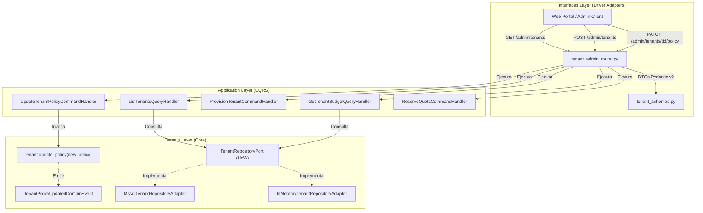

# Roadmap de Implementación — CU-02: Contrato Estandarizado de Administración y Aislamiento Multi-Tenant (`/admin/tenants`)

Este documento constituye la especificación técnica y ruta de ejecución paso a paso para el **Caso de Uso 02 (CU-02: Aislamiento y Contexto Multi-Tenant)**, sincronizado con [`docs/frontend_portal_use_cases.md`](../frontend_portal_use_cases.md), el **RFC-32** (especificación del contrato de inquilinos del portal web) y el **Paso 2** de la guía en vivo ([`README.md`](../../README.md)).

---

## 🎯 Objetivo del Caso de Uso

Evolucionar la suite administrativa `/admin/tenants` hacia un **contrato de gestión de inquilinos unificado, tolerante y enterprise**, resolviendo las asimetrías de identificadores (`id` vs `tenant_id`), enriqueciendo el payload de lectura con estructuras financieras (`financials`), límites operativos (`limits`) y metadatos (`metadata`), y consolidando el desacoplamiento estricto en Clean Architecture y CQRS.

```json
[
  {
    "id": "corp-acme",
    "tenant_id": "corp-acme",
    "name": "ACME Corporation",
    "status": "ACTIVE",
    "tier": "ENTERPRISE",
    "balance": "1000.0000",
    "reserved_amount": "0.0000",
    "available_balance": "1000.0000",
    "currency": "USD",
    "financials": {
      "currency": "USD",
      "balance": "1000.0000",
      "reserved_amount": "0.0000",
      "available_balance": "1000.0000",
      "monthly_budget_usd": "500.0000"
    },
    "limits": {
      "max_tokens_per_request": 16384,
      "max_requests_per_minute": 120
    },
    "metadata": {
      "created_at": "2026-09-15T10:00:00Z",
      "updated_at": "2026-10-15T11:30:00Z",
      "contact_email": "ops@acme.corp"
    }
  }
]
```

---

## 🏛️ Diagnóstico de Arquitectura y Deuda Técnica

Actualmente, el flujo de `/admin/tenants`:
- [ ] Presenta **asimetría de identificadores**: `GET /admin/tenants` devuelve `tenant_id`, mientras que `POST /admin/tenants` exige `id`, obligando a normalizaciones ad-hoc en el frontend.
- [ ] En [`src/domain/tenants/entities/tenant_policy.py`](../../src/domain/tenants/entities/tenant_policy.py), el catálogo de `TenantTier` solo contiene `FREE`, `STANDARD` y `ENTERPRISE`, omitiendo el nivel intermedio `PRO` (8,192 tokens/req) formalizado en RFC-32.
- [ ] En [`src/interfaces/http/routers/tenant_admin_router.py`](../../src/interfaces/http/routers/tenant_admin_router.py), el router está **sobrecargado (315 líneas)** conteniendo 7 esquemas Pydantic que deberían residir en un archivo dedicado (`tenant_schemas.py`).
- [ ] Viola los principios de **CQRS y Clean Architecture**: ejecuta lecturas directas a `unit_of_work.tenants.list()` y `unit_of_work.tenants.get()` dentro de las funciones del router, sin Query Handlers.
- [ ] Viola el **encapsulamiento DDD**: muta directamente el atributo privado del agregado en `update_tenant_policy` (`tenant._policy = updated_policy  # pyright: ignore[reportPrivateUsage]`), en lugar de proveer un método de negocio explícito `tenant.update_policy(...)`.
- [ ] En [`src/application/tenants/`](../../src/application/tenants/), solo existe la carpeta `commands/`; la subcarpeta `queries/` está completamente ausente.
- [ ] En [`README.md`](../../README.md#L345-L352), el bloque de ejemplo para la petición sin `X-Tenant-ID` (Paso 2.1) muestra erróneamente `HTTP Status: 201` en lugar de `HTTP Status: 400 Bad Request`.

---

## 📐 Diagrama de Flujo y Componentes (Ports & Adapters)



---

## 📋 Lista de Tareas y Checkboxes de Ejecución

### Fase 1: Capa de Dominio (Catálogo de Tiers, Invariantes y Encapsulamiento DDD)
- [x] **1.1 Extensión de Niveles de Servicio (`TenantTier`):**
  - En [`src/domain/tenants/entities/tenant_policy.py`](../../src/domain/tenants/entities/tenant_policy.py), incorporar el nivel `PRO = "PRO"`.
  - Agregar parámetro de tasa `max_requests_per_minute: int = 60` a `TenantPolicy`.
  - Crear método factoría `TenantPolicy.default_for_tier(tier: TenantTier)` con los techos de tokens oficiales:
    - `FREE`: 2,048 tokens/req
    - `STANDARD`: 4,096 tokens/req
    - `PRO`: 8,192 tokens/req
    - `ENTERPRISE`: 16,384 tokens/req
- [x] **1.2 Encapsulamiento y Eventos de Dominio en `Tenant`:**
  - En [`src/domain/tenants/entities/tenant.py`](../../src/domain/tenants/entities/tenant.py), agregar atributo opcional `contact_email: str | None = None`.
  - Implementar método de negocio `update_policy(self, policy: TenantPolicy) -> None` que actualice la política, modifique `_updated_at` y emita el evento de dominio.
- [x] **1.3 Evento de Dominio `TenantPolicyUpdatedDomainEvent`:**
  - En [`src/domain/tenants/events/tenant_events.py`](../../src/domain/tenants/events/tenant_events.py), definir `TenantPolicyUpdatedDomainEvent`.
  - Exportar en [`src/domain/tenants/events/__init__.py`](../../src/domain/tenants/events/__init__.py).

### Fase 2: Capa de Aplicación (CQRS Queries & Commands)
- [x] **2.1 Subcarpeta y Exportaciones de Queries:**
  - Crear carpeta `src/application/tenants/queries/`.
  - Crear `src/application/tenants/queries/__init__.py`.
- [x] **2.2 Query y QueryHandler para Listado de Tenants:**
  - Crear `src/application/tenants/queries/list_tenants_query.py`:
    - `ListTenantsQuery`: DTO de consulta inmutable.
    - `TenantSummaryDTO`: DTO que contiene tanto los campos planos (`balance`, `available_balance`) como los agrupados (`financials`, `limits`, `metadata`).
    - `ListTenantsQueryHandler`: Orquesta la lectura desacoplada consumiendo `unit_of_work.tenants.list()`.
- [x] **2.3 Query y QueryHandler para Consulta de Presupuesto:**
  - Crear `src/application/tenants/queries/get_tenant_budget_query.py`:
    - `GetTenantBudgetQuery`: DTO de consulta con `tenant_id: str`.
    - `TenantBudgetDTO`: DTO con `id`, `tenant_id`, `balance`, `reserved_amount`, `available_balance`, `currency`.
    - `GetTenantBudgetQueryHandler`: Obtiene el tenant o lanza `TenantNotFoundError`.
- [x] **2.4 Command y CommandHandler para Actualización de Políticas:**
  - Crear `src/application/tenants/commands/update_tenant_policy_command.py`:
    - `UpdateTenantPolicyCommand`: DTO de comando con `tenant_id`, `tier`, `max_tokens_per_request`, `monthly_budget_usd`, `max_requests_per_minute`, `allowed_models`.
    - `UpdateTenantPolicyResult`: DTO de resultado.
    - `UpdateTenantPolicyCommandHandler`: Orquesta la actualización mediante `tenant.update_policy(...)` y commit atómico.
- [x] **2.5 Adaptación de `ProvisionTenantCommand`:**
  - En `src/application/tenants/commands/provision_tenant_command.py`, añadir soporte para `contact_email` y `max_requests_per_minute`, garantizando que `ProvisionTenantResult` exponga tanto `id` como `tenant_id`.

### Fase 3: Capa de Interfaces (Driver Schemas Pydantic v2 & Router Modular)
- [ ] **3.1 Extracción de Esquemas a `tenant_schemas.py`:**
  - Crear [`src/interfaces/http/tenant_schemas.py`](../../src/interfaces/http/tenant_schemas.py).
  - Definir esquemas estructurados Pydantic v2:
    - `TenantFinancialsSchema`: `currency`, `balance`, `reserved_amount`, `available_balance`, `monthly_budget_usd`.
    - `TenantLimitsSchema`: `max_tokens_per_request`, `max_requests_per_minute`.
    - `TenantMetadataSchema`: `created_at`, `updated_at`, `contact_email`.
    - `TenantSummaryResponse`: Exposición dual de `id` y `tenant_id`, campos aplanados para compatibilidad y subobjetos enriquecidos.
    - `CreateTenantRequest`: Soporte de `id` como canónico y `tenant_id` como fallback opcional, `contact_email`, etc.
    - `TenantBudgetResponse`: Exposición dual de `id` y `tenant_id`.
    - `UpdateTenantPolicyRequest` y `TenantPolicyResponse`.
    - `ReserveQuotaRequest` y `ReserveQuotaResponse`.
- [ ] **3.2 Refactorización de `tenant_admin_router.py`:**
  - Limpiar [`src/interfaces/http/routers/tenant_admin_router.py`](../../src/interfaces/http/routers/tenant_admin_router.py):
    - Inyectar los 5 handlers CQRS (`provision_handler`, `list_handler`, `get_budget_handler`, `update_policy_handler`, `reserve_quota_handler`).
    - Eliminar acceso directo al `UnitOfWorkPort` y mutación privada de entidades.
    - Reducir el router a ~100 líneas limpias y declarativas.
- [ ] **3.3 Sincronización en `api.py` y `container.py`:**
  - Actualizar `build_api` en [`src/interfaces/http/api.py`](../../src/interfaces/http/api.py) para inyectar los handlers de tenants.
  - En [`src/container.py`](../../src/container.py), instanciar los nuevos handlers y conectarlos al composition root.

### Fase 4: Capa de Persistencia e Infraestructura (Mappers & Adapters)
- [ ] **4.1 Soporte en Mappers:**
  - En [`src/infrastructure/persistence/mssql/tenant_mapper.py`](../../src/infrastructure/persistence/mssql/tenant_mapper.py), soportar el nivel `PRO` y los campos `contact_email` y `max_requests_per_minute`.
- [ ] **4.2 Verificación de Aislamiento Multi-Tenant:**
  - Validar [`src/interfaces/http/middlewares/tenant_context_middleware.py`](../../src/interfaces/http/middlewares/tenant_context_middleware.py) asegurando que `X-Tenant-Id` y `X-Tenant-ID` se propaguen con total aislamiento en endpoints de negocio y se omitan en `/admin/*`.

### Fase 5: Batería de Pruebas Automatizadas (TDD & Regresión)
- [ ] **5.1 Pruebas Unitarias de Dominio:**
  - Crear `tests/unit/domain/test_tenant_policy_tiers.py` validando los 4 tiers, defaults y el método `Tenant.update_policy` con emisión de `TenantPolicyUpdatedDomainEvent`.
- [ ] **5.2 Pruebas Unitarias de Aplicación (CQRS):**
  - Crear `tests/unit/application/test_list_tenants_query.py` validando la proyección de DTOs enriquecidos y aplanados.
  - Crear `tests/unit/application/test_get_tenant_budget_query.py` validando consulta y excepción `TenantNotFoundError`.
  - Crear `tests/unit/application/test_update_tenant_policy_command.py` validando actualización transaccional.
- [ ] **5.3 Pruebas Unitarias de Interfaces:**
  - Crear `tests/unit/interfaces/http/test_tenant_schemas.py` verificando serialización dual `id`/`tenant_id`, exclusión de nulos y tolerancia de lectura.
- [ ] **5.4 Pruebas de Integración End-to-End:**
  - Actualizar `tests/integration/api/test_tenant_admin_router.py` validando el nuevo contrato RFC-32 en `/admin/tenants`.
  - Verificar `tests/integration/api/test_tenant_middleware_isolation.py`.
  - Verificar `tests/integration/test_walkthrough_happy_path.py` (Paso 2).
- [ ] **5.5 Barrera de Calidad Total:**
  - Ejecutar `make check-all` asegurando 0 errores Ruff, 0 errores Pyright, 0 alertas Bandit y 100% de tests en verde.

### Fase 6: Documentación, ADR 0021 y Sincronización del Diagrama Vivo
- [ ] **6.1 Formalización de ADR 0021:**
  - Crear `.agent/architecture/decisions/0021-multi-tenant-contract-standardization-and-cqrs-isolation.md`.
- [ ] **6.2 Sincronización del Diagrama Vivo:**
  - Actualizar [`.agent/architecture/system-map.mermaid.md`](../../.agent/architecture/system-map.mermaid.md) con `TenantSchemas`, `ListTenantsQueryHandler`, `GetTenantBudgetQueryHandler` y `UpdateTenantPolicyCommandHandler`.
- [ ] **6.3 Corrección en Guía de Ejecución (`README.md`):**
  - En [`README.md`](../../README.md#L345-L352), corregir el snippet del Paso 2.1 para mostrar `HTTP Status: 400 Bad Request` y el mensaje de error de tenant obligatorio.
- [ ] **6.4 Actualización de Índice Maestro:**
  - Registrar el enlace a este roadmap en [`docs/roadmap.md`](../roadmap.md).
- [ ] **6.5 Regeneración de OpenAPI y ReDoc:**
  - Exportar especificación OpenAPI 3.1 (`python -m src.interfaces.cli.export_openapi`) y validar `public/openapi.json` y `public/index.html`.
