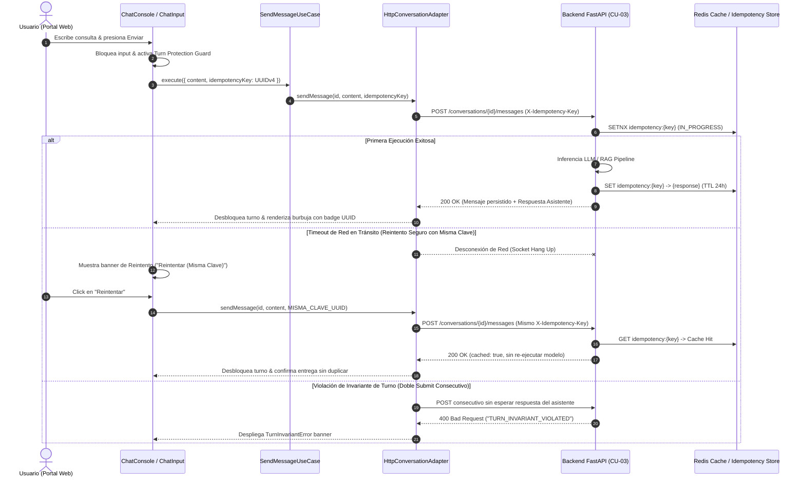

# RFC-33: Contrato Estandarizado de Mensajería Conversacional con Idempotencia Resiliente (`/conversations`)

- **RFC Number:** RFC-33
- **Título:** Especificación del Contrato de Mensajería, Invariante de Turnos y Deduplicación Idempotente mediante UUIDv4
- **Fecha:** 2026-10-15
- **Autor:** Equipo Frontend Portal (Portal Web & Clean Architecture)
- **Destinatarios:** Equipo Backend (`apps/chatbot/service/api`), Seguridad, Arquitectura de Datos y AI Core
- **Estado:** PROPUESTO (En proceso de adopción)
- **Caso de Uso Vinculado:** CU-03: Consola Conversacional con Idempotencia Resiliente

---

## 1. Resumen Ejecutivo

Este documento formaliza y propone el contrato de API unificado para la gestión del ciclo de vida de conversaciones y el intercambio de mensajes entre el cliente web y el backend de inferencia conversacional (`FastAPI / Uvicorn`), accesible bajo la ruta base `/conversations`.

Durante la auditoría de arquitectura del **CU-03 (Consola Conversacional & Idempotencia)**, se identificaron escenarios críticos en redes inestables o móviles:

1. **Doble Envío Accidental (*Double Submit*):** Clics repetidos del usuario en el botón de envío que provocan ejecuciones duplicadas de pipelines LLM costosos.
2. **Desconexiones de Red en Vuelo (*In-Flight Retries*):** Reintentos automáticos del cliente tras timeouts HTTP que causan bifurcaciones en el historial o respuestas repetidas.
3. **Ausencia de Endpoint Estandarizado de Lectura de Historial (`GET /conversations/{id}`):** Falta de un contrato explícito para hidratar la consola con mensajes previos y sus respectivas claves de idempotencia.

Para garantizar la consistencia transaccional, mitigar costos de inferencia redundante y asegurar una experiencia táctil determinista en la interfaz neubrutalista 3D, este documento establece:

1. El uso obligatorio del encabezado HTTP `X-Idempotency-Key` (formato UUIDv4 RFC 4122) en toda mutación de mensajes.
2. La definición formal de las invariantes de turno cliente-servidor (prevención de turnos consecutivos sin respuesta).
3. La especificación técnica de los endpoints `POST /conversations`, `POST /conversations/{id}/messages` y la propuesta de `GET /conversations/{id}`.
4. La matriz de códigos de error HTTP de dominio (`400 Bad Request`, `409 Conflict`, `422 Unprocessable Entity`).
5. La documentación del patrón *Tolerant Reader* implementado en el portal frontend para mantener tolerancia absoluta a variaciones de contrato sin caídas de servicio (*Zero-Downtime Resilience*).

---

## 2. Diagnóstico de la Auditoría y Hallazgos Actuales

### 2.1 Estado de los Endpoints en Backend (`apps/chatbot/service/api`)

La inspección del catálogo OpenAPI y las rutas activas de FastAPI revela las siguientes firmas operativas:

#### Creación de Conversación

- **Ruta:** `POST /conversations`
- **Cabeceras:** `X-Tenant-Id: <string>`
- **Payload:** `{ "title": "Migración Cloud Enterprise 2026" }`
- **Respuesta Actual:**

  ```json
  {
    "id": "conv-3a81f3b0-21a4-4a57-9d7b-bc4097f48e23",
    "title": "Migración Cloud Enterprise 2026",
    "created_at": "2026-10-15T18:30:00Z"
  }
  ```

#### Envío de Mensajes con Idempotencia

- **Ruta:** `POST /conversations/{conversation_id}/messages`
- **Cabeceras:** `X-Tenant-Id: <string>`, `X-Idempotency-Key: <uuid-v4>`
- **Payload:** `{ "content": "Calcular presupuesto de infraestructura cloud." }`
- **Respuesta Actual:**

  ```json
  {
    "id": "msg-8f1e2c4d",
    "conversation_id": "conv-3a81f3b0-21a4-4a57-9d7b-bc4097f48e23",
    "role": "assistant",
    "content": "Para estimar el presupuesto de infraestructura cloud...",
    "idempotency_key": "9b1deb4d-3b7d-4bad-9bdd-2b0d7b3dcb6d",
    "created_at": "2026-10-15T18:30:05Z"
  }
  ```

### 2.2 Discrepancias y Puntos de Dolor Detectados

1. **Ausencia de `GET /conversations/{conversation_id}`:**
   - La API actual solo provee mutaciones (`POST`). El portal web necesita reconstruir la lista de mensajes tras una recarga de página o alternancia de pestaña. Actualmente el frontend utiliza memoria local o proxies tolerantes cuando este endpoint retorna 404/405.
2. **Gestión de Respuestas en Caché para Idempotencia:**
   - Cuando se reenvía la misma clave `X-Idempotency-Key`, el backend debe devolver exactamente la misma respuesta HTTP 200 sin invocar nuevamente el agente LangChain ni consumir tokens LLM. Si la clave aún está siendo procesada, debe emitir `409 Conflict` con código de error legible.
3. **Invariante de Alternancia de Turnos:**
   - El backend debe rechazar peticiones concurrentes o consecutivas de un usuario en la misma conversación si el turno del asistente aún no ha concluido (`400 Turn Invariant Violated`), protegiendo la coherencia del árbol de memoria del agente.

---

## 3. Especificación Técnica Propuesta

### 3.1 Creación de Conversación: `POST /conversations`

**Ruta:** `POST /conversations`  
**Cabeceras Requeridas:**

- `Content-Type: application/json`
- `X-Tenant-Id: <tenant-slug>` (Obligatorio para aislamiento multi-tenant CU-02)

**Cuerpo de la Solicitud (`CreateConversationRequest`):**

```json
{
  "title": "Auditoría de Seguridad y Presupuestos Cloud",
  "metadata": {
    "channel": "portal-web",
    "user_id": "usr-admin-01"
  }
}
```

**Respuesta Exitosa (`201 Created` / `200 OK`):**

```json
{
  "id": "conv-8a7c6e5d-4f3b-2a1c-9e8d-7c6b5a4f3e2d",
  "title": "Auditoría de Seguridad y Presupuestos Cloud",
  "tenant_id": "corp-acme",
  "created_at": "2026-10-15T19:00:00Z",
  "status": "ACTIVE"
}
```

---

### 3.2 Envío de Mensaje con Idempotencia: `POST /conversations/{conversation_id}/messages`

**Ruta:** `POST /conversations/{conversation_id}/messages`  
**Cabeceras Requeridas:**

- `Content-Type: application/json`
- `X-Tenant-Id: <tenant-slug>`
- `X-Idempotency-Key: <uuid-v4>` (RFC 4122 v4)

**Cuerpo de la Solicitud (`SendMessageRequest`):**

```json
{
  "content": "Calcular presupuesto de infraestructura cloud para 500k usuarios mensuales."
}
```

**Respuesta Exitosa (`200 OK` / `201 Created`):**

```json
{
  "id": "msg-992a8e71",
  "conversation_id": "conv-8a7c6e5d-4f3b-2a1c-9e8d-7c6b5a4f3e2d",
  "role": "assistant",
  "content": "Basado en la arquitectura multi-tenant y un volumen estimado de 500k usuarios, el costo de cómputo en clúster Kubernetes y bases de datos particionadas se proyecta en $1,450 USD/mes.",
  "idempotency_key": "4c9d8a1f-3b7e-4a6c-9f8e-1b2c3d4e5f6a",
  "created_at": "2026-10-15T19:00:03Z",
  "tokens_consumed": 184,
  "cached": false
}
```

> **Comportamiento Idempotente:**  
> Si se recibe una petición posterior con la misma cabecera `X-Idempotency-Key: 4c9d8a1f-3b7e-4a6c-9f8e-1b2c3d4e5f6a` y el mismo `conversation_id`, el backend responde de inmediato con el payload almacenado en Redis y el indicador `"cached": true`, sin consumir cuota de tokens.

---

### 3.3 Propuesta de Lectura de Historial: `GET /conversations/{conversation_id}`

**Ruta:** `GET /conversations/{conversation_id}`  
**Cabeceras Requeridas:**

- `Accept: application/json`
- `X-Tenant-Id: <tenant-slug>`

**Respuesta Exitosa (`200 OK`):**

```json
{
  "id": "conv-8a7c6e5d-4f3b-2a1c-9e8d-7c6b5a4f3e2d",
  "title": "Auditoría de Seguridad y Presupuestos Cloud",
  "tenant_id": "corp-acme",
  "created_at": "2026-10-15T19:00:00Z",
  "can_append_user_message": true,
  "messages": [
    {
      "id": "msg-001",
      "role": "user",
      "content": "Calcular presupuesto de infraestructura cloud.",
      "idempotency_key": "4c9d8a1f-3b7e-4a6c-9f8e-1b2c3d4e5f6a",
      "created_at": "2026-10-15T19:00:01Z",
      "delivery_status": "DELIVERED"
    },
    {
      "id": "msg-002",
      "role": "assistant",
      "content": "Para estimar el presupuesto de infraestructura cloud...",
      "idempotency_key": "4c9d8a1f-3b7e-4a6c-9f8e-1b2c3d4e5f6a",
      "created_at": "2026-10-15T19:00:03Z",
      "delivery_status": "DELIVERED"
    }
  ]
}
```

---

## 4. Matriz de Errores e Invariantes del Dominio

| Código HTTP | Error Code | Causa Raíz | Acción del Frontend Portal |
| --- | --- | --- | --- |
| `400 Bad Request` | `TURN_INVARIANT_VIOLATED` | El cliente intentó enviar un mensaje de usuario mientras el asistente aún está procesando el turno anterior o hay una violación de orden. | Muestra el banner `TurnInvariantError` ("Esperando respuesta del Asistente") y bloquea el campo de texto. |
| `409 Conflict` | `IDEMPOTENCY_IN_PROGRESS` | Otra petición con el mismo `X-Idempotency-Key` está en ejecución concurrente. | Espera exponencial con jitter (Backoff) y sondea el resultado. |
| `409 Conflict` | `IDEMPOTENCY_PAYLOAD_MISMATCH` | Se reutilizó un `X-Idempotency-Key` previo pero con un contenido (`content`) diferente al original. | Despliega alerta de colisión de clave y regenera un nuevo UUIDv4. |
| `422 Unprocessable Entity` | `INVALID_UUID_FORMAT` | El encabezado `X-Idempotency-Key` no cumple con la expresión regular RFC 4122 v4. | Rechazo inmediato de entrada; regeneración estricta de UUIDv4. |
| `404 Not Found` | `CONVERSATION_NOT_FOUND` | El identificador de conversación no existe para el `X-Tenant-Id` proporcionado. | Ofrece creación automática de nueva conversación neubrutalista. |

---

## 5. Implementación en Frontend: Patrón Tolerant Reader & CQRS

En `src/infrastructure/api/HttpConversationAdapter.ts`, el frontend implementa lectura tolerante y desacoplamiento limpio:

```typescript
// 1. Inyección de Headers y Generación de Idempotencia
const idempotencyKey = providedKey || crypto.randomUUID();
const headers: Record<string, string> = {
  'Content-Type': 'application/json',
  'X-Idempotency-Key': idempotencyKey,
};

// 2. Traducción de Errores de Negocio
if (response.status === 409) {
  throw new IdempotencyConflictError(idempotencyKey, 'La clave de idempotencia colisiona con una operación existente');
}
if (response.status === 400) {
  throw new TurnInvariantError(conversationId, 'Invariante de turnos violada: el cliente no puede enviar turnos consecutivos');
}

// 3. Tolerant Reader para Conversaciones y Mensajes
const rawId = raw.id || raw.conversation_id || conversationId;
return new ConversationAggregate(
  ConversationId.create(rawId),
  raw.title || 'Conversación Activa',
  new Date(raw.created_at || Date.now()),
  messages,
  raw.can_append_user_message ?? (messages.length === 0 || messages[messages.length - 1].role !== 'user')
);
```

---

## 6. Diagrama de Secuencia Mermaid: Ciclo de Vida de Idempotencia

El siguiente diagrama detalla la interacción entre el Portal Web, la Capa de Aplicación CQRS, la API de FastAPI y el almacenamiento en caché de Redis ante desconexiones y reintentos:



---

## 7. Evidencias Visuales de la Interfaz Neubrutalista 3D

Las pruebas de integración y capturas automatizadas con Puppeteer generadas en la Fase 5 demuestran el cumplimiento en vivo de todas las invariantes visuales y táctiles:

### 7.1 Consola Conversacional por Defecto con Sugerencias Enterprise Cloud

Muestra el encabezado 3D, el indicador de Idempotencia Activa (UUIDv4) y los chips rápidos empresariales:


### 7.2 Modal Neubrutalista 3D de Creación de Conversación

Ventana modal accesible (`role="dialog"`) con validación de título, sombras mecánicas sólidas y creación determinista:


### 7.3 Guardia de Turno en Tránsito (Turn Protection Guard)

Banner reactivo de turno protegido con candado e indicador pulsante, bloqueando el campo de entrada para evitar doble envío:


### 7.4 Hilo Conversacional Completo con Micro-Badges de Idempotencia

Mensajes confirmados con etiqueta monoespaciada `IDEMPOTENCY: <uuid>` en cada burbuja, garantizando trazabilidad contractual:


---

## 8. Plan de Transición y Adopción

1. **Inmediato (Sprint Actual):**  
   El portal frontend opera con `HttpConversationAdapter` y fallback a `MockConversationGateway` mediante `runtimeEnvironmentStore.getMode()`, garantizando operatividad total y desarrollo desacoplado.
2. **Semana 1:**  
   Backend valida la inclusión de la cabecera `X-Idempotency-Key` en FastAPI mediante dependencia `Header(..., alias="X-Idempotency-Key")` y almacenamiento en Redis (`SETNX`).
3. **Semana 2:**  
   Implementación formal del endpoint `GET /conversations/{conversation_id}` retornando la lista de mensajes históricos y el booleano `can_append_user_message`.
4. **Semana 3:**  
   Verificación end-to-end de pruebas de carga y fallas de red simuladas contra el clúster local de desarrollo.

---

## 9. Aprobaciones Requeridas

- [ ] Líder Técnico Frontend
- [ ] Arquitecto de Software Backend & AI Core
- [ ] Especialista en Seguridad y Aislamiento Multi-Tenant
